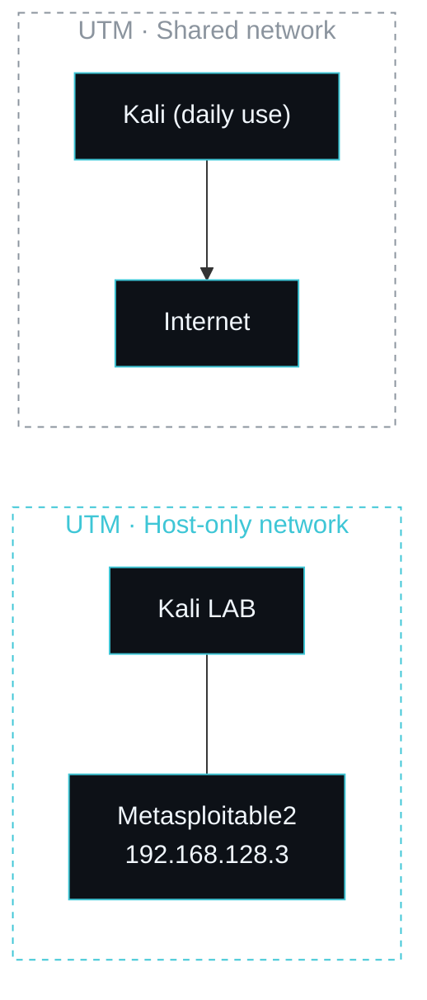

<p align="center">
  
</p>

<p align="center">
  
</p>

<p align="center">
  
  
  
  
  
  
  
</p>

<p align="center">
  <a href="https://github.com/elena-lucero/cybersecurity-portfolio"><b>← Back to portfolio</b></a>
</p>


## `$ cat overview.txt`

This was my first practical cybersecurity lab. I created an isolated environment with Kali Linux and Metasploitable2 to practise network scanning, service identification and basic vulnerability analysis.

| | |
|---|---|
| **Date** | 29 September 2026 |
| **Environment** | Personal isolated lab |
| **Target** | Metasploitable2 |
| **Objective** | Identify exposed services and understand the impact of an unauthenticated root shell |
| **Authorization** | Authorized testing on my own machines |


## `$ cat architecture.txt`

The lab uses two separate network environments. The vulnerable machine and Kali LAB are connected through a host-only network, while my daily Kali machine keeps its internet connection through a shared network.



The purpose of this configuration is to prevent the vulnerable machine from being directly exposed to the internet or the physical network.


## `$ cat lab_setup.txt`

### 1. Preparing the disk image

I downloaded the Metasploitable2 image from SourceForge and installed QEMU using Homebrew.

I converted the virtual disk from VMDK to QCOW2 using `qemu-img`:

```bash
qemu-img convert -f vmdk -O qcow2 <image>.vmdk <image>.qcow2
```

### 2. Configuring the virtual machine

I created the Metasploitable2 machine in UTM with the following configuration:

| Setting | Configuration |
|---|---|
| Host architecture | ARM |
| Guest architecture | x86_64 |
| Execution mode | Emulation |
| Boot mode | Legacy BIOS |
| Network mode | Host-only |

My Mac uses an ARM processor, while Metasploitable2 uses an x86 architecture. For this reason, I used emulation instead of native virtualization.

I disabled UEFI because the machine did not boot correctly with this configuration.

### 3. Network isolation

I created a separate copy of Kali Linux called **Kali LAB** and connected it to the same host-only network as Metasploitable2.

My daily Kali machine remained on a shared network with internet access.

I tested the connection between the two lab machines using `ping`. The result showed **0% packet loss**.


## `$ cat methodology.txt`

### 1. Network discovery

I identified the IP address of Metasploitable2 and verified that both lab machines could communicate.

| Action | Command |
|---|---|
| Identify the target IP address | `ifconfig` |
| Verify network connectivity | `ping 192.168.128.3` |

**Target IP:** `192.168.128.3`

### 2. Service detection

I performed an initial Nmap scan to identify open ports, running services and their versions.

```bash
nmap -sV 192.168.128.3
```

The scan remained at 0% during the ARP discovery stage for more than five minutes.

### 3. Troubleshooting

I changed the scan options and performed a second scan.

```bash
nmap -sV -Pn -n -T4 192.168.128.3
```

| Option | Purpose |
|---|---|
| `-sV` | Detect service versions |
| `-Pn` | Skip the normal host discovery phase |
| `-n` | Disable DNS resolution |
| `-T4` | Use a more aggressive timing template |

**Result:** The second scan completed successfully in 52.70 seconds.

The exact cause of the initial delay was not confirmed. However, the modified scan configuration worked in my lab environment.

Note: Nmap may still use ARP on local Ethernet networks even when `-Pn` is enabled.


## `$ cat scan_results.txt`

The scan identified several exposed network services.

| Port | Service | Security consideration |
|---|---|---|
| `1524/tcp` | Bind shell | Unauthenticated root access |
| `2121/tcp` | ProFTPD 1.3.1 | Legacy FTP service requiring vulnerability review |
| `3306/tcp` | MySQL | Exposed database service |
| `5432/tcp` | PostgreSQL | Exposed database service |
| `5900/tcp` | VNC | Remote desktop service |
| `6000/tcp` | X11 | Exposed graphical display service |
| `6667/tcp` | UnrealIRCd | IRC service requiring version and vulnerability review |
| `8180/tcp` | Apache Tomcat | Exposed application server |

Nmap also reported Unix/Linux operating system information through service detection. A dedicated operating system detection scan was not performed.

The presence of an open port does not automatically confirm a vulnerability.

For this lab, I selected port `1524/tcp` for further analysis.


## `$ cat vulnerability_analysis.txt`

### Unauthenticated bind shell

A bind shell is a shell that listens on a network port and allows remote connections.

In Metasploitable2, this service is intentionally exposed for security training.

| | |
|---|---|
| **Port** | 1524/TCP |
| **Service** | Bind shell |
| **Vulnerability** | Missing authentication |
| **Access level** | Root |
| **Security impact** | Critical |

### Procedure

I connected to the exposed bind shell using Netcat:

```bash
nc 192.168.128.3 1524
```

The connection immediately provided access to a shell without requiring a username or password.

I verified my current user:

```bash
whoami
```

Output:

```text
root
```

I then inspected the local user accounts:

```bash
cat /etc/passwd
```

The file contained information about the system accounts, including:

| Account | Observation |
|---|---|
| `root` | Administrative account with UID 0 |
| `msfadmin` | Regular user account with UID 1000 |
| `user` | Additional test account |

The password field contained `x`, indicating that password information is stored separately in `/etc/shadow`.

I did not access `/etc/shadow`, because it was not necessary for the objective of this lab.

### Security impact

The procedure was simple because the service was already exposed and did not require authentication. No additional exploit or credentials were necessary.

An attacker with network access to this service could gain root privileges and potentially compromise all three elements of the CIA triad:

| Security principle | Potential impact |
|---|---|
| Confidentiality | Unauthorized access to sensitive information |
| Integrity | Unauthorized modification of files and configurations |
| Availability | Disruption of services or system operations |

These are potential consequences of the vulnerability. I did not perform destructive actions or modify the target system.


## `$ cat defensive_considerations.txt`

The following recommendations are based on the identified vulnerability. They are theoretical defensive measures and were not implemented or tested during this lab.

### Prevention and mitigation

- Remove unauthorized or unnecessary bind shells.
- Disable unnecessary network services.
- Restrict network access using firewall rules.
- Apply network segmentation.
- Apply the principle of least privilege.
- Require authentication for legitimate remote access services.
- Perform regular security audits and vulnerability assessments.
- Maintain an inventory of authorized services and open ports.

### Detection and monitoring

| Indicator | What a security analyst could investigate |
|---|---|
| Unexpected listening port | Possible unauthorized network service |
| Unexpected TCP connection | Possible unauthorized remote access |
| Network-facing shell running as root | Suspicious process with elevated privileges |
| Unusual command execution | Possible unauthorized system activity |
| Changes to sensitive files | Possible compromise of system integrity |

These indicators could be investigated through network monitoring, process monitoring, system logs and endpoint security tools.

They represent possible detection opportunities, not confirmed alerts collected during this lab.


## `$ cat lessons_learned.txt`

- The importance of network isolation when working with vulnerable machines.
- The difference between virtualization and emulation.
- How to identify open ports, network services and service versions using Nmap.
- How different Nmap options affect scan behaviour.
- How to troubleshoot network scanning problems.
- How to establish a network connection using Netcat.
- How to verify user privileges in Linux.
- The purpose of `/etc/passwd` and `/etc/shadow`.
- The difference between an exposed service and a confirmed vulnerability.
- The security risks of unauthenticated services running with root privileges.


## `$ cat conclusion.txt`

This lab helped me understand the importance of network isolation, service identification and access control.

I gained practical experience in building an isolated lab, performing network scans, troubleshooting technical problems and verifying the security impact of an exposed service.

The main lesson was that a serious security vulnerability does not always require a complex attack. A single unauthenticated service running with elevated privileges can put an entire system at risk.


<p align="center">
  
</p>
