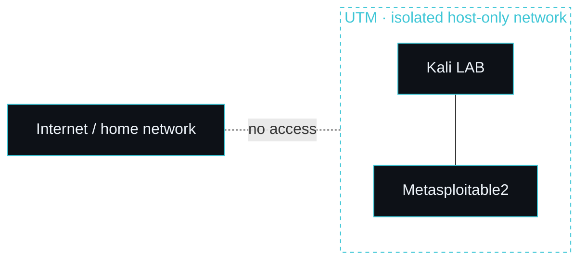

<p align="center">
  
</p>

<p align="center">
  <a href="https://github.com/elena-lucero/cybersecurity-portfolio"></a>
</p>

<p align="center"><code>UTM</code> <code>Kali Linux</code> <code>Metasploitable2</code> <code>Host-only network</code></p>


## `$ cat overview.txt`

A safe space to practise: an attacker machine and an intentionally vulnerable target,
running as virtual machines in **UTM** on my Mac and connected only to each other.

| Machine | Role |
|---|---|
| **Kali LAB** | Dedicated copy of Kali Linux used only for this lab |
| **Metasploitable2** | Intentionally vulnerable Linux machine, built for security practice |


## `$ cat architecture.txt`




## `$ cat why_isolated.txt`

Metasploitable2 is vulnerable on purpose, so it must never be reachable from the internet
or from my home network. Using a **host-only network** in UTM keeps both machines
in their own closed space: they can see each other, and nothing else.


## `$ cat setup.txt`

1. Created a dedicated copy of Kali Linux in UTM, **Kali LAB**, so my main Kali stays separate.
2. Added **Metasploitable2** as a second virtual machine in UTM.
3. Connected both machines to the same **host-only** network.
4. Checked that they can reach each other.


## `$ ping metasploitable2`

Connectivity between both machines confirmed with `ping` from Kali LAB:

```bash
ping -c 4 <METASPLOITABLE2_IP>
```

<p align="center">
  
</p>
