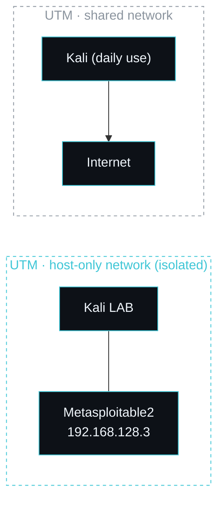

<p align="center">
  
</p>

<p align="center">
  
</p>

<p align="center">
  
  
  
</p>

<p align="center">
  <a href="https://github.com/elena-lucero/cybersecurity-portfolio"><b>← Back to portfolio</b></a>
</p>


## `$ cat overview.txt`

| | |
|---|---|
| **Date** | 29.9.2026 |
| **Goal** | Build an isolated lab with an intentionally vulnerable machine and run my first real reconnaissance scan |
| **Authorization** | Not applicable: my own machine, in my own isolated lab |


## `$ cat architecture.txt`




## `$ cat lab_setup.txt`

- Downloaded the official **Metasploitable2** image from SourceForge (Rapid7 project).
- Converted the disk from `.vmdk` to `.qcow2` with `qemu-img`, after installing `qemu` via Homebrew:

  ```bash
  qemu-img convert -f vmdk -O qcow2 <image>.vmdk <image>.qcow2
  ```

- Created the VM in **UTM** with emulated **x86_64** architecture: my Mac is ARM, so this runs emulated, not virtualized.
- **Disabled UEFI boot** in the QEMU settings: this old image needs classic BIOS/Legacy boot, otherwise it gets stuck in a UEFI shell.
- Set Metasploitable2's network to **host-only**: isolated, no internet access and not visible from my real Wi-Fi.
- Created a dedicated copy of my Kali, **Kali LAB**, also on host-only, separate from my everyday Kali (which stays on a shared network with internet).
- Confirmed connectivity between both machines with `ping`: **0% packet loss**.


## `$ history`

| # | Step | Command |
|:-:|---|---|
| 1 | Log in to Metasploitable2 | user `msfadmin` / password `msfadmin` |
| 2 | Get its IP address | `ifconfig` → `192.168.128.3` |
| 3 | Check connectivity from Kali LAB | `ping 192.168.128.3` |
| 4 | First scan attempt | `nmap -sV 192.168.128.3` → stuck for 5+ min on "ARP Ping Scan", 0% done |
| 5 | Final scan | `nmap -sV -Pn -n -T4 192.168.128.3` → finished in **52.70 s** |


## `$ cat scan_results.txt`

Most relevant open services:

| Port | Service | Note |
|---|---|---|
| `1524/tcp` | bindshell | "Metasploitable root shell": a root backdoor with no password, left on purpose for exploitation practice |
| `6667/tcp` | irc · UnrealIRCd | Version with a well-known, widely documented vulnerability |
| `2121/tcp` | ftp · ProFTPD 1.3.1 | Also has a known vulnerability |
| `3306/tcp` · `5432/tcp` | mysql · postgresql | Two exposed databases |
| `5900/tcp` · `6000/tcp` · `8180/tcp` | vnc · X11 · Apache Tomcat | More exposed services |

Nmap identified the operating system (Unix/Linux) from the service fingerprints alone, without being asked to.


## `$ nc 192.168.128.3 1524`

**Exploiting the bindshell (port 1524)**

- Connected with `nc 192.168.128.3 1524` and got a shell straight away, with no username or password.
- Confirmed full access with `whoami` → `root`.
- Listed all system users with `cat /etc/passwd`, a typical step after gaining access, to get to know the system:
  - `root` always has ID `0`; `msfadmin` (the legitimate user) has ID `1000`; there is a test user `user` described literally as "just a user".
  - The password column shows `x` for everyone: the real hashed passwords live in `/etc/shadow`, not here. I did not open that file, to avoid going further than this practice needed.


## `$ cat lessons_learned.txt`

- By default, `nmap -sV` runs an ARP ping scan and DNS resolution before scanning. On an isolated network with no DNS, this can hang the scan indefinitely.
- Fix: `-Pn` (skip host discovery) + `-n` (no DNS resolution) + `-T4` (faster timing). Especially useful on host-only lab networks.
- Before assuming a VM has frozen, check whether it is just the screensaver: a click + Enter wakes the screen without affecting the system.
- Keeping a dedicated copy of Kali for the lab, instead of reconfiguring my everyday one, avoids losing internet access on my main Kali.
- An unauthenticated service (like the bindshell on port 1524) is one of the most serious vulnerabilities there is: there is nothing to "hack", you just connect.
- `cat/etc/passwd` (no space) fails because bash reads it as a single command name; `cat /etc/passwd` (with a space) is a command plus an argument, two separate things.

<p align="center">
  
</p>
