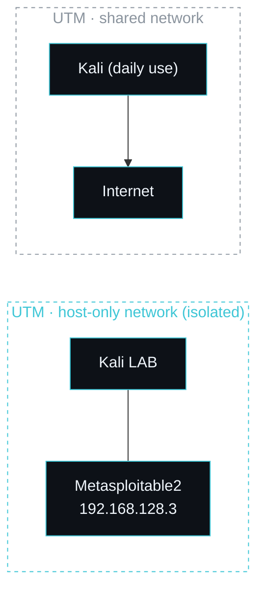

<p align="center">
  
</p>

<p align="center">
  
</p>

<p align="center">
  
  
  
  
  
  
  
</p>

<p align="center">
  <a href="https://github.com/elena-lucero/cybersecurity-portfolio"><b>← Back to portfolio</b></a>
</p>


## `$ cat overview.txt`

| | |
|---|---|
| **Date** | 29.9.2026 |
| **Goal** | Build my own isolated lab with a vulnerable machine and do my first real scan |
| **Permission** | Not needed: it is my own machine, in my own isolated lab |


## `$ cat architecture.txt`




## `$ cat lab_setup.txt`

- I downloaded the official **Metasploitable2** image from SourceForge (a Rapid7 project).
- I installed `qemu` with Homebrew. Then I changed the disk format from `.vmdk` to `.qcow2` with `qemu-img`:

  ```bash
  qemu-img convert -f vmdk -O qcow2 <image>.vmdk <image>.qcow2
  ```

- I created the virtual machine in **UTM** with **x86_64** emulation. My Mac has an ARM chip, so the machine is emulated, not virtualized.
- I turned off **UEFI boot** in the QEMU settings. This old image needs the classic BIOS (Legacy) boot. With UEFI, it stops in a UEFI shell.
- I put Metasploitable2 on a **host-only** network. It is isolated: it has no internet and my real Wi-Fi cannot see it.
- I made a copy of my Kali only for the lab, called **Kali LAB**, also on host-only. My daily Kali stays on a shared network with internet.
- I tested the connection between the two machines with `ping`: **0% packet loss**.


## `$ history`

| # | Step | Command |
|:-:|---|---|
| 1 | Log in to Metasploitable2 | user `msfadmin` / password `msfadmin` |
| 2 | Find its IP address | `ifconfig` → `192.168.128.3` |
| 3 | Test the connection from Kali LAB | `ping 192.168.128.3` |
| 4 | First scan | `nmap -sV 192.168.128.3` → stopped for more than 5 min on "ARP Ping Scan", 0% done |
| 5 | Final scan | `nmap -sV -Pn -n -T4 192.168.128.3` → finished in **52.70 s** |


## `$ cat scan_results.txt`

The most important open services:

| Port | Service | Note |
|---|---|---|
| `1524/tcp` | bindshell | "Metasploitable root shell": a root backdoor with no password, left there on purpose for practice |
| `6667/tcp` | irc · UnrealIRCd | A version with a very well-known vulnerability |
| `2121/tcp` | ftp · ProFTPD 1.3.1 | It also has a known vulnerability |
| `3306/tcp` · `5432/tcp` | mysql · postgresql | Two open databases |
| `5900/tcp` · `6000/tcp` · `8180/tcp` | vnc · X11 · Apache Tomcat | More open services |

Nmap also found the operating system (Unix/Linux) only from the service information. I did not ask for it.


## `$ nc 192.168.128.3 1524`

**Using the bindshell (port 1524)**

- I connected with `nc 192.168.128.3 1524` and I got a shell at once, with no user and no password.
- I checked my access with `whoami` → `root`: full control.
- I listed all the users of the system with `cat /etc/passwd`. This is a normal step after you get access, to understand the system:
  - `root` always has ID `0`. `msfadmin` (the real user) has ID `1000`. There is a test user, `user`, with the description "just a user".
  - The password column shows `x` for all users. The real passwords (as hashes) are in `/etc/shadow`, not here. I did not open that file, because this practice did not need it.


## `$ cat lessons_learned.txt`

- By default, `nmap -sV` does an ARP ping scan and DNS lookups before the scan. On an isolated network with no DNS, the scan can stop forever.
- The solution: `-Pn` (do not check if the host is up) + `-n` (no DNS) + `-T4` (faster). This is very useful on host-only lab networks.
- Before I think a virtual machine is frozen, I check if it is only the screensaver. A click + Enter wakes up the screen and does not change the system.
- A separate copy of Kali for the lab is better than changing my daily Kali. This way my main Kali does not lose its internet.
- A service with no login (like the bindshell on port 1524) is one of the worst vulnerabilities: there is nothing to "hack", you only connect.
- `cat/etc/passwd` (no space) does not work, because bash reads it as one command name. `cat /etc/passwd` (with a space) is a command and an argument: two different things.

<p align="center">
  
</p>
