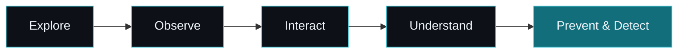

  

  

  
  
  
  

  <a href="https://elena-lucero.github.io/"><b>← Back to portfolio</b></a>

## `$ cat overview.txt`

| | |
|---|---|
| **Project** | vulneria. |
| **Started** | November 2026 |
| **Type** | Interactive educational web application |
| **Focus** | Cybersecurity threats and attack mechanisms |
| **Status** | Work in progress |
| **Development** | AI-assisted |

## `$ cat about.txt`

vulneria was born from a personal need. When I started studying cybersecurity, I came from a completely different professional background. I needed a tool that would help me visualize and understand the technical concepts I was learning.

I couldn't find a tool that offered the visual and interactive learning experience I was looking for, so I decided to create one myself.

Building vulneria is also part of my own learning journey. Researching threats and finding ways to represent them visually helps me develop my technical knowledge.

I hope this project can help students, people changing careers and cybersecurity professionals looking for an educational resource or a quick reference.

### My contribution

I lead the project with AI-assisted development, focusing on:

- Project concept, educational approach and visual identity.
- Interface structure, functionality and user experience.
- Content organization and technical research.
- Interactive simulation design.
- Technical review, functional testing and error correction.

My goal is to create an accessible and useful educational resource for the cybersecurity community.

## `$ cat learning_method.txt`

vulneria goes beyond traditional definitions. It uses interactive simulations to explain how threats work, how systems become compromised and how attacks can be prevented or detected.

All simulations are educational representations. They do not perform real attacks against external systems.

## `$ cat categories.txt`

| Category | Description |
|---|---|
| **Attacks** | Techniques used to compromise systems, networks or users |
| **Incidents** | Real cybersecurity incidents and historical attacks |
| **Malware** | Malicious software and its behavior |
| **Vectors** | Methods used to deliver threats or gain initial access |
| **Vulnerabilities** | Weaknesses that can be exploited |

## `$ cat features.txt`

- Interactive, step-by-step animated simulations.
- Technical definitions, comparisons and analysis.
- Prevention and detection strategies.
- Trusted technical references and related terms.
- Intelligent search and category filters.
- Audio narration and multilingual support.
- Desktop and mobile experience.

  
  
  
  
  

Interactive simulations and multilingual content are currently under development.

## `$ cat security_audit.txt`

Before the public release, I plan to perform a security audit of vulneria, including source code review, vulnerability assessment, hardening and penetration testing in a controlled environment.

I will document the findings, security measures, corrections and test results as a separate project in my cybersecurity portfolio.

This phase will help me put my cybersecurity knowledge into practice.

**I don't just want to create a website about cybersecurity. I also want to learn how to protect it.**

## `$ cat roadmap.txt`

- [x] Concept and visual identity
- [x] Structure and core functionality
- [x] Technical content organization
- [ ] Interactive simulations
- [ ] Multilingual content
- [ ] Final technical review and testing
- [ ] Security audit and vulnerability assessment
- [ ] Hardening, penetration testing and remediation
- [ ] Public release
- [ ] Security monitoring and maintenance

  <b>Don't memorize it. Understand it.</b>

  <i>Visualize how digital threats work.</i>

  

