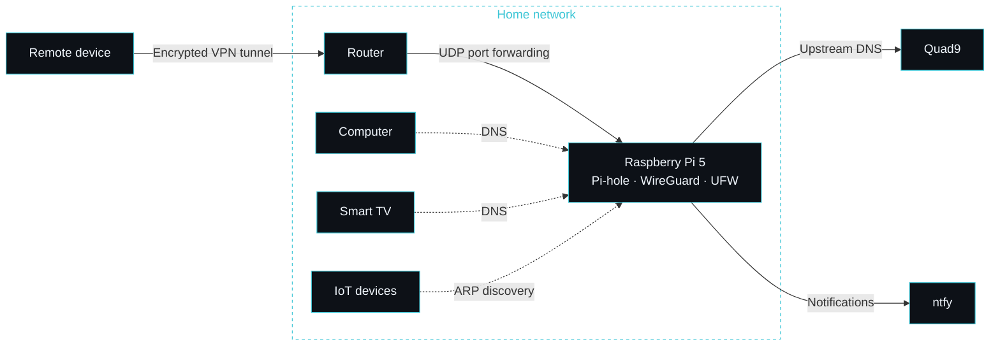
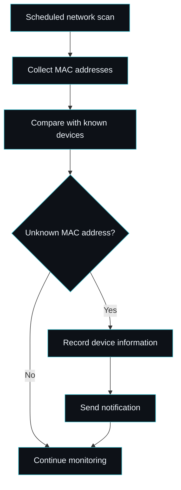
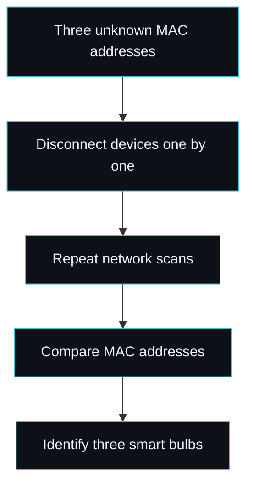

<p align="center">
  
</p>

<p align="center">
  
</p>

<p align="center">
  
  
  
  
</p>

<p align="center">
  <a href="https://github.com/elena-lucero/cybersecurity-portfolio"><b>← Back to portfolio</b></a>
</p>


## `$ cat overview.txt`

In this project, I built a Raspberry Pi home server to practise Linux administration, networking, DNS filtering, secure remote access and basic network monitoring.

| | |
|---|---|
| **Date** | 25 October 2026 |
| **Environment** | Personal home network |
| **Hardware** | Raspberry Pi 5 (1 GB RAM), 64 GB microSD |
| **Operating system** | Raspberry Pi OS Lite (64-bit) |
| **Authorization** | Personal network and devices |

### Objectives

- Filter unwanted DNS requests using Pi-hole.
- Configure secure remote access using WireGuard.
- Apply basic server hardening measures.
- Monitor the local network and receive alerts when unknown devices appear.

Network addresses and personal configuration details have been anonymized for privacy.


## `$ cat architecture.txt`



| Function | Tools |
|---|---|
| System administration | Linux, SSH, NetworkManager |
| DNS filtering | Pi-hole, Quad9, StevenBlack |
| Remote access | WireGuard, iptables |
| Server security | UFW, SSH keys, unattended-upgrades |
| Network monitoring | arp-scan, Cron, ntfy |
| Configuration backups | SCP, Pi-hole Teleporter |


## `$ cat implementation.txt`

### 01 · Raspberry Pi setup

I installed Raspberry Pi OS Lite using Raspberry Pi Imager. I selected the Lite version because the server does not need a graphical desktop.

I enabled SSH, connected the Raspberry Pi to my router through Ethernet and updated the system from my Mac.

```bash
ssh <user>@<hostname>.local
sudo apt update && sudo apt full-upgrade -y
sudo reboot
```

### 02 · DNS filtering with Pi-hole

I installed Pi-hole to filter DNS requests and block domains associated with ads and trackers.

```bash
curl -sSL https://install.pi-hole.net | bash
sudo pihole setpassword
```

| Setting | Configuration |
|---|---|
| Upstream DNS | Quad9 |
| Blocklist | StevenBlack |
| Blocklist size at setup | Approximately 71,000 domains |
| Client configuration | Manual DNS settings |

I configured my computer, smartphone and smart TV to use the Raspberry Pi as their DNS server.

I did not change the DNS configuration for the entire network.

Pi-hole filters DNS requests. It does not replace a firewall, antivirus or endpoint protection solution.

### 03 · Static IP configuration

I configured a static IP address using NetworkManager to keep the DNS and VPN services available at a consistent network address.

```bash
sudo nmcli connection modify "Wired connection 1" \
  ipv4.method manual \
  ipv4.addresses "<raspberry-ip>/24" \
  ipv4.gateway "<router-ip>" \
  ipv4.dns "9.9.9.9 149.112.112.112"

sudo nmcli connection up "Wired connection 1"
```

I also reserved the same address on my router using the Raspberry Pi's MAC address.

### 04 · WireGuard VPN

I installed and configured WireGuard manually, without an automatic VPN installation tool.

```bash
sudo apt install -y wireguard qrencode iptables
```

The configuration included:

- Separate public and private keys for the server and client.
- Restricted permissions for private key files using `umask 077`.
- A dedicated VPN subnet.
- IPv4 forwarding and NAT.
- UDP port forwarding on the router.
- Pi-hole as the DNS server for the VPN client.

**Server configuration — `/etc/wireguard/wg0.conf`**

```ini
[Interface]
Address = 10.8.0.1/24
ListenPort = 51820
PrivateKey = <server-private-key>

PostUp = iptables -t nat -A POSTROUTING -s 10.8.0.0/24 -o eth0 -j MASQUERADE
PostDown = iptables -t nat -D POSTROUTING -s 10.8.0.0/24 -o eth0 -j MASQUERADE

[Peer]
PublicKey = <client-public-key>
AllowedIPs = 10.8.0.2/32
```

I enabled IPv4 forwarding and started the VPN service.

```bash
echo 'net.ipv4.ip_forward=1' | sudo tee /etc/sysctl.d/99-wireguard.conf
sudo sysctl -p /etc/sysctl.d/99-wireguard.conf
sudo systemctl enable --now wg-quick@wg0
sudo wg show
```

I configured one UDP port forwarding rule on my router and imported the client configuration into my smartphone using a QR code.

The VPN client uses `10.8.0.1` as its DNS server, allowing Pi-hole filtering outside my home network.

The VPN addresses shown here are example addresses. Private keys, public IP addresses and external port details are not published.


## `$ cat security.txt`

I applied basic server hardening measures to reduce unnecessary exposure and improve system security.

### SSH authentication

I configured SSH key authentication using Ed25519.

```bash
ssh-keygen -t ed25519 -C "mac"
ssh-copy-id <user>@<hostname>.local
```

Password authentication remained enabled as a backup.

### Automatic security updates

I installed `unattended-upgrades` and verified that automatic updates were enabled.

```bash
sudo apt install -y unattended-upgrades
cat /etc/apt/apt.conf.d/20auto-upgrades
```

### Firewall

I configured UFW to deny incoming connections by default and allow outgoing connections.

```bash
sudo apt install -y ufw
sudo ufw default deny incoming
sudo ufw default allow outgoing
```

I added rules for the services used by the server.

| Port | Protocol | Purpose |
|---|---|---|
| 22 | TCP | SSH administration |
| 53 | TCP/UDP | DNS resolution |
| 80 | TCP | Pi-hole web interface |
| 5353 | UDP | mDNS resolution |
| 51820 | UDP | WireGuard VPN |

I also allowed traffic forwarding from the VPN interface to the Ethernet interface.

```bash
sudo ufw route allow in on wg0 out on eth0
sudo ufw enable
sudo ufw status verbose
```

Only the WireGuard service was configured for port forwarding on the router.

UFW protects the Raspberry Pi itself. It does not act as a firewall for every device on the home network.

### Configuration backups

| Component | Backup method |
|---|---|
| Pi-hole | Teleporter |
| WireGuard | SCP |

I saved copies of the service configurations on my Mac. Backup restoration was not tested during this project.


## `$ cat network_monitoring.txt`

### Unknown device detection

I configured a basic monitoring system to discover unknown devices on my local network and send notifications to my phone.

| Tool | Function |
|---|---|
| arp-scan | Discover devices on the local network |
| Cron | Run scheduled scans every five minutes |
| ntfy | Send notifications |



The monitoring script compares discovered MAC addresses with a list of known devices.

```bash
sudo apt install -y arp-scan cron
sudo arp-scan --localnet --quiet --plain
```

I scheduled the script to run every five minutes using Cron.

```bash
echo '*/5 * * * * root /usr/local/bin/alarma-intrusos.sh' | sudo tee /etc/cron.d/alarma-intrusos
```

**Test result:** The system detected my smart TV when it first appeared and sent one notification.

This is a basic device discovery and notification system, not a complete intrusion detection system (IDS).

An unknown MAC address does not automatically indicate malicious activity.

### Network inventory investigation

During a network scan, I discovered three unknown devices with similar MAC address prefixes and no identified manufacturer.

```bash
sudo arp-scan --localnet
```

I investigated the devices manually.



**Result:** All three unknown devices were identified as smart bulbs.

This investigation helped me understand the importance of maintaining a network inventory and verifying unknown devices before considering them a security threat.


## `$ cat results.txt`

<p align="center">
  
  
  
</p>

| Component | Observed result |
|---|---|
| **Pi-hole** | Blocked 38 of 250 DNS requests during one website test (15.2%) |
| **WireGuard** | Remote connection verified using mobile data |
| **Remote DNS filtering** | Pi-hole continued filtering DNS requests through the VPN |
| **Server security** | Firewall, SSH keys and automatic updates configured |
| **Device alerts** | Smart TV detected and notification received |
| **Network inventory** | Three unknown devices successfully identified |
| **Backups** | Pi-hole and WireGuard configurations saved |

The DNS blocking percentage represents one specific test, not the general effectiveness of Pi-hole.


## `$ cat troubleshooting.txt`

### DNS resolution

**Problem:** The router administration page became unavailable after configuring Pi-hole.

**Cause:** Pi-hole could not resolve the local hostname used by the router.

**Solution:** I added a local DNS record pointing to the router's private IP address and cleared the DNS cache on my Mac.

**Status:** Resolved.

### VPN port forwarding

**Problem:** My internet provider uses shared public IPv4 addresses and restricts the available external ports.

**Solution:** I selected an external UDP port within the assigned range and forwarded it to the WireGuard service.

**Status:** Remote VPN access verified.

### WhatsApp connectivity

**Problem:** WhatsApp did not connect when using the VPN outside my home network, while other applications worked.

Possible causes to investigate:

- VPN MTU configuration.
- IPv6 routing configuration.

Possible tests include reducing the MTU to `1280` and reviewing the IPv6 routes in the client configuration.

**Status:** Unresolved at the time of the original project.


## `$ cat lessons_learned.txt`

- The importance of DNS resolution and consistent network addressing.
- How to configure an encrypted VPN tunnel manually.
- How IP forwarding, NAT and port forwarding work together.
- The importance of limiting exposed network services.
- How to protect private keys and configure SSH key authentication.
- How to automate network discovery and notifications.
- How to investigate and identify unknown network devices.
- The importance of testing configuration changes before closing an active SSH session.

### Future improvements

The following measures have not been implemented or tested as part of this project:

- Disable SSH password authentication after verifying key-based access.
- Restrict firewall rules by source address and network interface.
- Separate IoT devices from the main network.
- Test backup restoration.
- Improve device monitoring and reduce false alerts.
- Investigate the remaining VPN connectivity issue.

### Conclusion

This project helped me develop practical skills in Linux administration, networking and basic system security.

I learned how to configure network services, apply security controls, automate monitoring and investigate unknown devices in a real home environment.

<p align="center">
  <i>Learning by doing. Learning by understanding.</i>
</p>

<p align="center">
  
</p>
