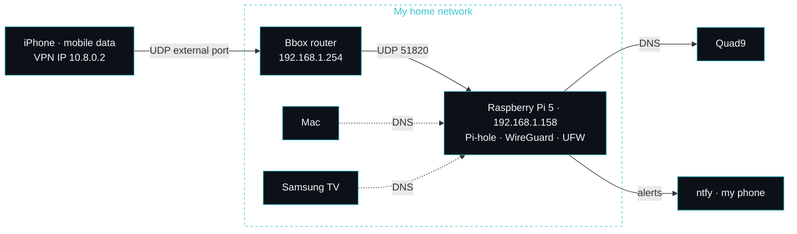

<p align="center">
  
</p>

<p align="center">
  
</p>

<p align="center">
  
  
  
  
</p>

<p align="center">
  <a href="https://github.com/elena-lucero/cybersecurity-portfolio"><b>← Back to portfolio</b></a>
</p>


## `$ cat overview.txt`

| | |
|---|---|
| **Date** | October 25, 2026 |
| **Goal** | Build my own home server with a Raspberry Pi 5 |
| **Environment** | My own home network and my own devices |
| **Equipment** | Raspberry Pi 5 (1 GB), case, fan, heatsinks, 27 W power supply, 64 GB microSD card, MacBook Air, Bouygues Telecom Bbox Wi-Fi 6 router |

**My main goals:**

- Block ads and trackers on my devices with Pi-hole.
- Set up a personal VPN to connect safely when I am away from home.
- Make the server more secure with a firewall, automatic updates and SSH keys.
- Get an alert when an unknown device connects to my network.


## `$ cat tools.txt`

| Category | Tools & Technologies |
|---|---|
| Hardware | Raspberry Pi 5 (1 GB), MacBook Air, Bbox Wi-Fi 6 Router |
| Operating System | Raspberry Pi OS Lite (64-bit) |
| System Setup | Raspberry Pi Imager, NetworkManager, `nmcli` |
| DNS & Ad Blocking | Pi-hole, Quad9, StevenBlack Blocklist |
| VPN & Networking | WireGuard, `iptables`, `qrencode` |
| System Security | UFW, SSH, SSH Keys, unattended-upgrades |
| Network Monitoring | arp-scan, Cron, ntfy |
| Backup & Administration | `scp`, Pi-hole Teleporter, Linux command line |


## `$ cat architecture.txt`




## `$ cat 01_raspberry_setup.txt`

- I put the Raspberry Pi inside its case and installed the fan.
- I could only install one small heatsink, because the others were too close to the fan.
- I installed **Raspberry Pi OS Lite (64-bit)** with Raspberry Pi Imager. I chose this version because it does not need a desktop.
- I turned on SSH and connected the Raspberry Pi to my router with an Ethernet cable.
- Then I connected from my Mac and updated the system:

```bash
ssh <user>@<raspberry-name>.local
sudo apt update && sudo apt full-upgrade -y
sudo reboot
```


## `$ cat 02_pihole.txt`

I installed Pi-hole to block ads and trackers with DNS.

```bash
curl -sSL https://install.pi-hole.net | bash
sudo pihole setpassword
```

| Setting | Value |
|---|---|
| **DNS provider** | Quad9 (filtered, with DNSSEC) |
| **Blocklist** | StevenBlack, about 71,000 domains |
| **Devices** | Mac, iPhone and Samsung TV |

I changed the DNS settings by hand on these devices, to use the IP address of my Raspberry Pi. I did not change the DNS for the whole network.

> **Problem: the router page did not open**
> After I started using Pi-hole, I could not open the settings page of my router. The router used a local name that Pi-hole did not know.
>
> **Solution:** I added a local DNS record in Pi-hole, `mabbox.bytel.fr → 192.168.1.254`, and I cleared the DNS cache on my Mac. After this, the router page opened again.


## `$ cat 03_static_ip.txt`

I wanted my Raspberry Pi to always keep the same IP address, so I set a static IP with NetworkManager:

```bash
sudo nmcli connection modify "Wired connection 1" ipv4.method manual \
  ipv4.addresses 192.168.1.158/24 ipv4.gateway 192.168.1.254 \
  ipv4.dns "9.9.9.9 149.112.112.112"
sudo nmcli connection up "Wired connection 1"
```

I also reserved the same IP address on my router, with the MAC address of the Raspberry Pi.

**Result:** the Raspberry Pi uses `192.168.1.158`.


## `$ cat 04_wireguard_vpn.txt`

I installed WireGuard to reach my home network when I am away. I set it up by hand, without automatic installation tools.

```bash
sudo apt install -y wireguard qrencode iptables
```

**Security keys**

I created separate keys for the server and for my iPhone. Only root can read the private keys.

```bash
sudo sh -c 'umask 077; cd /etc/wireguard; wg genkey | tee servidor.key | wg pubkey > servidor.pub; wg genkey | tee iphone.key | wg pubkey > iphone.pub'
```

**Server configuration:** `/etc/wireguard/wg0.conf`

```ini
[Interface]
Address = 10.8.0.1/24
ListenPort = 51820
PrivateKey = <server private key>
PostUp = iptables -t nat -A POSTROUTING -s 10.8.0.0/24 -o eth0 -j MASQUERADE
PostDown = iptables -t nat -D POSTROUTING -s 10.8.0.0/24 -o eth0 -j MASQUERADE

[Peer]
# iPhone
PublicKey = <iPhone public key>
AllowedIPs = 10.8.0.2/32
```

I turned on IP forwarding and started WireGuard:

```bash
echo 'net.ipv4.ip_forward=1' | sudo tee /etc/sysctl.d/99-wireguard.conf
sudo sysctl -p /etc/sysctl.d/99-wireguard.conf
sudo systemctl enable --now wg-quick@wg0
sudo wg show
```

**Router port forwarding**

I opened only one UDP port on my router:

| External port | Internal port | Destination |
|:-:|:-:|---|
| `<external port>` | `51820` | Raspberry Pi |

My internet provider shares public IPv4 addresses between customers. Because of this, my router only accepted external ports between `16384` and `24575`.

**iPhone configuration**

- I made a QR code with `qrencode` to add the VPN to my iPhone.
- I set `DNS = 10.8.0.1`, so my iPhone uses Pi-hole when I am away from home.
- I turned on automatic VPN connection with mobile data and with Wi-Fi networks outside my home.


## `$ cat 05_server_security.txt`

**SSH keys:** I created an SSH key on my Mac. I kept password login as a backup.

```bash
ssh-keygen -t ed25519 -C "mac"
ssh-copy-id <user>@<raspberry-name>.local
```

**Automatic updates:** I installed automatic security updates and checked that both settings were on (`1`).

```bash
sudo apt install -y unattended-upgrades
cat /etc/apt/apt.conf.d/20auto-upgrades
```

**Firewall (UFW):** it blocks incoming connections by default. I only allowed the ports that my services need.

```bash
sudo apt install -y ufw
sudo ufw default deny incoming
sudo ufw default allow outgoing
sudo ufw allow 22/tcp comment 'SSH'
sudo ufw allow 53 comment 'Pi-hole DNS'
sudo ufw allow 80/tcp comment 'Pi-hole panel'
sudo ufw allow 5353/udp comment 'mDNS (.local)'
sudo ufw allow 51820/udp comment 'WireGuard'
sudo ufw route allow in on wg0 out on eth0 comment 'VPN to internet'
sudo ufw enable
sudo ufw status verbose
```

**Backups:** I saved my Pi-hole settings with **Settings → Teleporter**, and I copied the `/etc/wireguard` folder to my Mac with `scp`.


## `$ cat 06_device_alerts.txt`

I made a system that finds unknown devices on my network:

| Tool | What it does |
|---|---|
| **arp-scan** | Finds the devices connected to the local network |
| **Cron** | Runs the script every five minutes |
| **ntfy** | Sends notifications to my phone |

The script compares the MAC addresses it finds with a list of known devices. If it finds a new MAC address, it saves the information and sends an alert.

```bash
sudo apt install -y arp-scan cron
sudo arp-scan --localnet --quiet --plain
echo '*/5 * * * * root /usr/local/bin/alarma-intrusos.sh' | sudo tee /etc/cron.d/alarma-intrusos
```

**Result:** the system found my Samsung TV the first time it connected, and it sent only one notification.


## `$ cat 07_network_inventory.txt`

I used arp-scan to check the devices on my network:

```bash
cd /tmp && sudo arp-scan --localnet
```

The scan showed IP addresses, MAC addresses and, when available, the manufacturer. I found **three unknown devices** with similar MAC address prefixes, and with no manufacturer.

**How I found them:** I disconnected my devices one by one, repeated the scan and checked which MAC addresses disappeared.

**Result:** the three unknown devices were the three smart bulbs in my lamp.


## `$ cat results.txt`

| Area | Result |
|---|---|
| **Pi-hole** | Worked on my Mac, iPhone and Samsung TV. On a news website test, it blocked **38 of 250 requests (15%)** |
| **WireGuard VPN** | Worked with mobile data. My iPhone appeared in Pi-hole as `10.8.0.2`, and Pi-hole kept blocking trackers outside my home |
| **Server security** | Static IP, active firewall, automatic security updates, SSH keys and configuration backups |
| **Device alerts** | Found my Samsung TV when it first connected, with one notification |
| **Network inventory** | All three unknown devices were smart bulbs |


## `$ cat open_issue.txt`

WhatsApp did not connect when I used the VPN outside my home network. Other apps worked well.

**Possible solutions to test:**

- Change the VPN MTU to `1280`.
- Remove `::/0` from `AllowedIPs` on the iPhone, because the VPN only uses IPv4.

**Status:** not solved yet.


## `$ cat lessons_learned.txt`

1. **Open only the ports you need.** I opened only one UDP port for WireGuard. I did not use DMZ, because it could show more services of my Raspberry Pi to the internet.
2. **Check settings before you change them.** Before I change important settings, I check the current configuration:
   - `nmcli`: check the network settings.
   - `sshd -t`: check the SSH configuration.
   - `grep -v PrivateKey`: show a configuration file without the lines with `PrivateKey`.

   I also keep my SSH session open until I test the new connection from another terminal.
3. **Protect private keys.** Never share private keys. I used `umask 077` to protect the key files, and I did not show private keys when I checked configuration files.
4. **DNS can cause connection problems.** With Pi-hole as DNS, my router page did not open. A local DNS record and a clean DNS cache on my Mac solved it. This helped me understand how DNS works on a home network.
5. **Understand your internet provider.** My provider shares public IPv4 addresses and gives each customer a port range. I had to understand this to set up WireGuard correctly.
6. **MAC addresses do not always identify devices.** A MAC address can help, but the manufacturer is not always known. Disconnecting devices one by one helped me find the three smart bulbs.
7. **Smart devices need extra attention.** Smart home devices can be a security risk. A separate guest network can keep them away from the other devices on the main network.
8. **Network changes can take time.** My Samsung TV did not appear in Pi-hole at once. I learned to wait and check the configuration before I decide that something is wrong.


## `$ cat conclusion.txt`

In this project I built and configured my own home security server with a Raspberry Pi.

I used Pi-hole to block ads and trackers, WireGuard to connect to my home network, and UFW to control network connections. I also made a system that finds unknown devices and sends alerts to my phone.

This project helped me improve my practical skills in Linux, networking, DNS, VPNs and basic system security. I also learned to solve configuration problems and to document my work step by step.

<p align="center">
  
</p>
