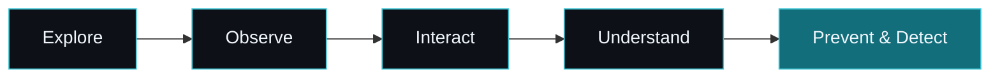

  

  

  
  
  
  

  <a href="https://github.com/elena-lucero/cybersecurity-portfolio"><b>← Back to portfolio</b></a>

## `$ cat overview.txt`

| | |
|---|---|
| **Project** | vulneria. |
| **Started** | November 2026 |
| **Type** | Interactive educational web application |
| **Focus** | Cybersecurity threats and attack mechanisms |
| **Goal** | Learning through visual understanding |
| **Status** | Work in progress |
| **Development** | AI-assisted |

## `$ cat about.txt`

Vulneria was born from a personal need to visualize cybersecurity threats in an interactive way. While studying cybersecurity, I realized that reading definitions was not always enough to fully understand how attacks work.

The main goal of Vulneria is to make digital threats easier to understand through interactive visualizations, technical explanations, and prevention and detection strategies.

This is not a cybersecurity lab or a demonstration of programming skills. It is purely an educational contribution to the cybersecurity community.

## `$ cat learning_method.txt`

I believe that understanding how something works is more useful than simply memorizing its definition.

Instead of relying only on written explanations or static images, Vulneria uses interactive simulations to show how digital threats work, step by step.

The idea is to observe how connections are established, how data moves, how systems become compromised, and how security mechanisms can help prevent or detect attacks.

## `$ cat categories.txt`

| Category | Description |
|---|---|
| **Attacks** | Techniques used to compromise systems, networks or users |
| **Malware** | Malicious software and its behavior |
| **Vectors** | Methods used to deliver threats or gain initial access |
| **Vulnerabilities** | Weaknesses that can be exploited |
| **Incidents** | Real cybersecurity incidents and historical attacks |

## `$ cat features.txt`

The project is designed around the following features:

- Interactive, step-by-step attack simulations.
- Animated connections, data packets and system states.
- Technical definitions and explanations.
- Comparisons between similar threats.
- Prevention and detection strategies.
- Technical analysis of attack mechanisms.
- Alphabetical navigation and category filters.
- Intelligent search and related terms.
- Audio explanations.
- Multilingual support.

  
  
  
  
  

Multilingual content is currently under development.

## `$ cat development.txt`

The application was developed using AI-assisted tools. My contribution focuses on the concept, visual design, content organization, and technical review.

The project is currently under development. Interactive simulations are being created progressively, with a focus on technical accuracy, accessibility and visual clarity.

All simulations are educational representations. They do not perform real attacks against external systems.

## `$ cat roadmap.txt`

- [x] Project concept and visual identity
- [x] Dictionary structure and categories
- [x] Search and filtering system
- [x] Technical content organization
- [ ] Complete interactive simulations
- [ ] Complete multilingual translations
- [ ] Technical review and testing
- [ ] Mobile experience improvements
- [ ] Public release

## `$ cat motivation.txt`

Vulneria is part of my own cybersecurity learning journey, and I hope it can also help others along theirs.

  <b>Don't memorize it. Understand it.</b>

  

