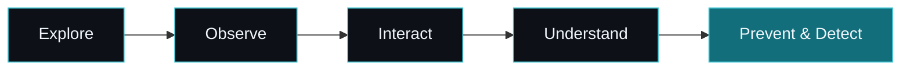
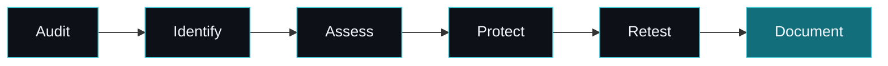

  

  

  
  
  
  

  <a href="https://elena-lucero.github.io/"><b>← Back to portfolio</b></a>

## `$ cat overview.txt`

| | |
|---|---|
| **Project** | vulneria. |
| **Started** | November 2026 |
| **Type** | Interactive educational web application |
| **Focus** | Cybersecurity threats and attack mechanisms |
| **Goal** | Learning through visual understanding |
| **Status** | Work in progress |
| **Development** | AI-assisted |
| **Security audit** | Planned before public release |

## `$ cat about.txt`

vulneria was born from a personal need. When I started studying cybersecurity, I came from a completely different professional background. I needed a tool that would help me visualize and understand the technical terms I was learning for the first time.

I couldn't find a tool that offered the visual and interactive learning experience I was looking for, so I decided to create one myself.

Building vulneria has also been a learning experience. Researching threats, understanding their mechanisms, and deciding how to represent them visually has helped me develop my own cybersecurity knowledge.

I hope vulneria can help other people who are changing careers or starting their cybersecurity journey, as well as professionals who need a quick reference or an educational resource to recommend to others.

### My contribution

I lead the project with AI-assisted development. My contribution includes:

- Project concept and educational approach.
- Visual identity and interface design.
- Interface structure and functional design.
- User experience and accessibility.
- Content organization and technical research.
- Design of interactive learning experiences.
- Technical review and content correction.
- Functional testing and error identification.
- Management of corrections and improvements.

This project is not intended to demonstrate programming skills, but to contribute an accessible and useful educational resource to the cybersecurity community.

**Don't memorize it. Understand it.**

*Visualize how digital threats work.*

## `$ cat learning_method.txt`

I believe that understanding how something works is more useful than simply memorizing its definition.

Instead of relying only on written explanations or static images, vulneria uses interactive simulations to show how digital threats work, step by step.

The idea is to observe how connections are established, how data moves, how systems become compromised, and how security mechanisms can help prevent or detect attacks.

## `$ cat categories.txt`

| Category | Description |
|---|---|
| **Attacks** | Techniques used to compromise systems, networks or users |
| **Incidents** | Real cybersecurity incidents and historical attacks |
| **Malware** | Malicious software and its behavior |
| **Vectors** | Methods used to deliver threats or gain initial access |
| **Vulnerabilities** | Weaknesses that can be exploited |

## `$ cat features.txt`

The project is designed around the following features:

- Interactive, step-by-step attack simulations.
- Animated connections, data packets and system states.
- Technical definitions and explanations.
- Comparisons between similar threats.
- Prevention and detection strategies.
- Technical analysis of attack mechanisms.
- Alphabetical navigation and category filters.
- Intelligent search and related terms.
- Audio explanations.
- Multilingual support.

  
  
  
  
  

Multilingual content is currently under development.

## `$ cat development.txt`

The project is currently under development. Interactive simulations are being created progressively, with a focus on technical accuracy, accessibility and visual clarity.

All simulations are educational representations. They do not perform real attacks against external systems.

## `$ cat security_audit.txt`

  
  

Before publishing vulneria, I want to do a security audit of my own web application.

First, I will review the source code and look for possible vulnerabilities. Then, I will perform security tests in a controlled environment to identify weaknesses.

After that, I will apply security measures, fix the problems and test the application again to make sure the corrections work.

### Planned security activities

- Source code security review.
- Attack surface analysis.
- Vulnerability assessment.
- External dependency review.
- Repository and access security.
- Application hardening.
- Penetration testing in a controlled environment.
- Vulnerability remediation and retesting.
- Security documentation.
- Security monitoring and maintenance after release.

I will document the entire process, including the vulnerabilities I find, the tools I use and the security measures I apply.

This security audit will be documented as a separate project in my cybersecurity portfolio, connected to vulneria.

**I don't just want to create a website about cybersecurity. I also want to learn how to protect it.**

The security audit has not started yet. It is a required phase before the public release.

## `$ cat roadmap.txt`

- [x] Project concept and visual identity
- [x] Dictionary structure and categories
- [x] Search and filtering system
- [x] Technical content organization
- [ ] Complete interactive simulations
- [ ] Complete multilingual translations
- [ ] Final technical review and testing
- [ ] Security audit and vulnerability assessment
- [ ] Hardening and penetration testing
- [ ] Vulnerability remediation and retesting
- [ ] Public release
- [ ] Security monitoring and maintenance

## `$ cat motivation.txt`

vulneria is part of my own cybersecurity learning journey, and I hope it can also help others along theirs.

  <b>Don't memorize it. Understand it.</b>

  

